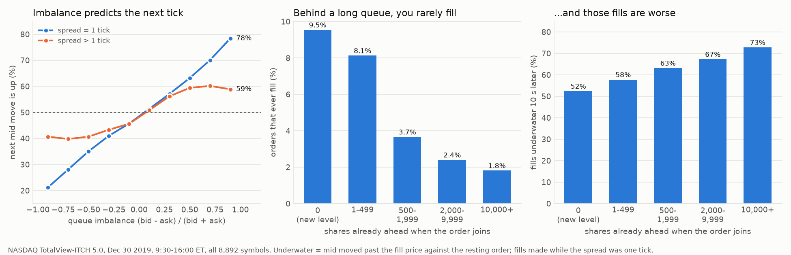

# VertexLadder

[](https://github.com/roshanshah11/vertexladder/actions/workflows/ci.yml)

A price-time priority matching engine in C++20, with a FIX 4.4 order-entry gateway and a
NASDAQ ITCH 5.0 replayer that rebuilds NASDAQ's order book for every stock it trades, order by
order, from NASDAQ's own feed.

Measured on an Apple M3 Pro laptop, one core for the book:

| | |
|---|---|
| Matching engine, synthetic lit-book flow (48% add, 40% cancel, 7% marketable IOC, 5% replace) | **49 M book ops/s, 20 ns mean**, p99.9 < 125 ns |
| Same flow with 1M orders resting (out of cache) | 13 M ops/s, 77 ns mean |
| Full NASDAQ trading day (Dec 30, 2019): 268.7M messages, 8,892 books | **26 s, 10.4 M messages/s** |
| ITCH validation: NASDAQ 'E' executions that hit the order our book had at the best price / first in line | **100.00% / 99.82%** of 5.72M |
| FIX order round trip over loopback TCP, one order in flight | **11 to 12 µs p50**, 4 to 5 µs above bare TCP (7.1 µs) in the same window |

Method, raw output and caveats (the M3's clock ticks every 41.7 ns, and what that does to
percentiles) are in [docs/BENCHMARKS.md](docs/BENCHMARKS.md). The reasoning behind every design
choice is in [docs/DESIGN.md](docs/DESIGN.md).

## What the NASDAQ day says

The same book, rebuilt from NASDAQ's feed, answers two market-making questions
([docs/RESEARCH.md](docs/RESEARCH.md)):

- **Queue imbalance predicts the next tick.** With a one-tick spread, when the bid has far more size
  than the ask, the next mid move is up 78% of the time (21% when it's the other way round); the
  sign of the imbalance calls the next move 63% of the time over 122M samples. With wider spreads
  it drops to 57%, the large-tick effect Gould and Bonart describe.
- **Queue position costs you twice.** Orders that join behind 10,000+ shares fill 1.8% of the time
  against 9.5% at the front, and 73% of their fills are underwater 10 seconds later against 52%.
  Inside the same stock, the longer queue fills less often in 92% of 914 stocks and gets the worse
  fills in 70% of 481.

<picture>
  <source media="(prefers-color-scheme: dark)" srcset="analysis/results/2019-12-30-dark.png">
  
</picture>

## Architecture

```
 FIX clients ──TCP──▶ gateway thread ──SPSC ring──▶ engine thread ──SPSC ring──▶ gateway thread ──TCP──▶ clients
                      sockets, FIX codec,           one OrderBook             ExecutionReports,
                      seq numbers, ClOrdIDs         per symbol                OrderCancelRejects
```

- **One thread owns every book.** No locks or atomics inside the book, its working set stays in
  one core's cache, and the output is a deterministic function of the input order, the way real
  venues sequence a book. Threads exist only at the edges and talk through two lock-free SPSC
  rings.
- **The book** (`include/vertexladder/order_book.hpp`): 32-byte order nodes in a contiguous pool,
  addressed by 32-bit handles, in an intrusive FIFO per price level (time priority is queue
  position). Each side is a vector of levels sorted worst to best, so the best price is `back()`
  and matching never searches. An open-addressing hash map with backward-shift deletion maps
  order id to node for O(1) cancels. Integer tick prices. No allocation once warm.
- **Order types**: limit (GTC/Day), IOC, FOK, market; cancel; cancel/replace that keeps queue
  priority on a size cut and loses it on anything else.
- **Gateway** (`src/gateway`): Boost.Asio sockets, busy-polled non-blocking on the hot path.
  Logon, heartbeats, test requests and sequence numbers are enforced; NewOrderSingle,
  OrderCancelRequest and OrderCancelReplaceRequest come in; ExecutionReports with
  LastQty/LastPx/CumQty/LeavesQty/AvgPx go out. Cancel-on-disconnect is on.
- **ITCH replayer** (`include/vertexladder/itch.hpp`): decodes ITCH 5.0 and mirrors NASDAQ's book
  through the same `OrderBook` data structures.

## Correctness

- **Differential test**: the book and a deliberately naive `std::map` reference book get the same
  random stream of 750k orders, cancels, replaces and bad inputs. Their event streams and full
  depth must match exactly. Planting a bug on purpose (wrong trade price, wrong priority rule, a
  flipped search predicate) fails it every time.
- **Real data**: across a full NASDAQ day, every one of NASDAQ's 5.72M 'E' executions lands on an
  order our book has at the best price, and 99.82% on the exact order our book has first in line.
  That's only possible if the book keeps NASDAQ's price-time order.
- **Races, reproduced on purpose**: a replace crossing a fill in flight, and a mass
  cancel-on-disconnect with both rings full, each have a deterministic test that fails on the
  earlier code and passes now.
- 59 tests (book semantics, hash map vs `std::unordered_map`, the SPSC ring across two threads,
  the FIX codec, ITCH decoding, and the gateway end to end over real TCP), clean under
  AddressSanitizer + UBSan and ThreadSanitizer. CI runs them with gcc and clang on Linux and on
  macOS.

## Build and run

Needs a C++20 compiler, CMake ≥ 3.20, and Boost ≥ 1.74 for the gateway (`brew install boost
googletest` or `apt install libboost-dev libgtest-dev zlib1g-dev`; GoogleTest is fetched if
missing).

```bash
cmake -S . -B build -DCMAKE_BUILD_TYPE=Release
cmake --build build -j
ctest --test-dir build

./build/bench_engine                         # matching benchmark
scripts/get_itch_sample.sh data              # 3.5 GB NASDAQ sample day
./build/bench_itch data/12302019.NASDAQ_ITCH50.gz --validate

./build/vl_server --port 9878 --symbols AAPL,MSFT,NVDA      # exchange
./build/vl_fix_client --port 9878 --orders 100000          # round-trip latency
```

Any FIX 4.4 client works against `vl_server` (SenderCompID of your choice, TargetCompID
`VERTEXLADDER`, prices as decimals, e.g. `44=101.25`).

## Layout

```
include/vertexladder/
  order_book.hpp      the book and matching
  flat_hash_map.hpp   order id -> node
  spsc_ring.hpp       lock-free single-producer single-consumer ring
  engine.hpp          engine thread: commands in, events out
  gateway.hpp         FIX gateway interface
  fix.hpp             FIX 4.4 codec interface
  itch.hpp            ITCH 5.0 decoder and book replayer
  clock.hpp, histogram.hpp   benchmark timing
src/fix/              FIX codec
src/gateway/          FIX gateway (Boost.Asio)
src/apps/             vl_server, vl_fix_client
bench/                bench_engine, bench_itch, bench_hop, bench_tcp_baseline
analysis/             microstructure study on the ITCH day, plots, results
tests/                unit, differential, hash map, ring, FIX, ITCH and gateway tests
docs/                 DESIGN.md, BENCHMARKS.md, RESEARCH.md
```

## Not done yet

Self-trade prevention, iceberg and hidden orders, auctions, FIX resend/replay (a sequence gap
ends the session), an input journal for crash recovery, a market-data publisher, core pinning
(needs Linux), and sharding symbols across more than one engine thread.

## License

MIT
